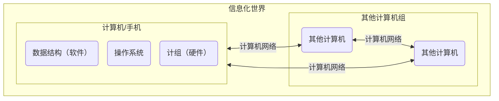
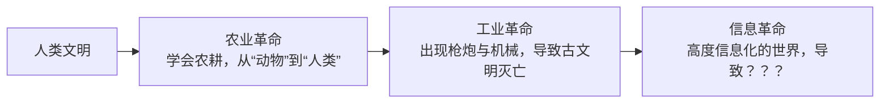
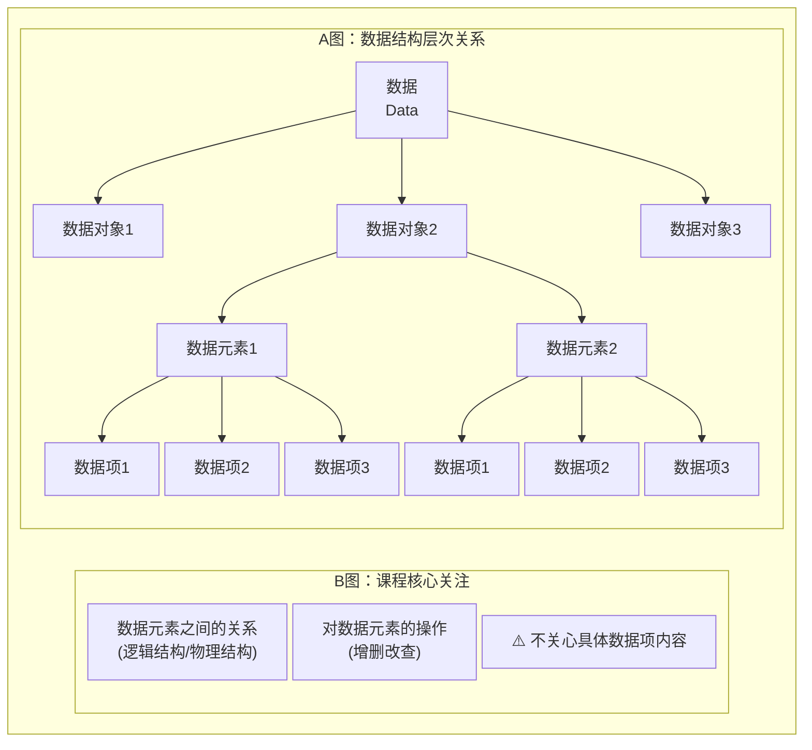

---
tags:
  - 408_计算机学科专业基础
创建时间: 2026-03-30T20:45:00
考试科目: "408"
课程: 数据结构
阶段: 基础
老师: 咸鱼
开始日期: 2026-03-30
结束日期:
---
[[2026-03-30]]
# 1. 绪论
## 1.0 开篇_数据结构在学什么

>[!Introduction]
>**数据结构在学什么？**
> - 如何用 **程序代码** 把现实世界的问题 **信息化**
> - 如何用计算机 **高效地** 处理这些信息从而创造价值

>[!example]
>人类是社会的发展，迄今经历了和经历着三个浪潮；第一次浪潮为农业阶段，从约1万年前开始；第二次浪潮为工业阶段，从17世纪末开始；第三次浪潮为正在到来的**信息化**阶段。—— 《第三次浪潮( 1980版 )，阿尔文·托夫勒》



>[!quote]
>”唯一可以确定的是，明天会使我们所有人大吃一惊。“ —— 阿尔文·托夫勒
>*The sole certainty is that tomorrow will surprise us all. —— Alvin Toffler*



---
[[2026-04-07]]
## 1.1 数据结构的基本概念

$$
\textbf{知识总览}
$$
$$
\textbf{数据结构}\left\{
\begin{array}{l}
\text{基本概念}\left\{
\begin{array}{l}
\text{数据} \\
\text{数据元素、数据项} \\
\text{数据对象、数据结构} \\
\text{数据类型、抽象数据类型（ADT）}
\end{array}\right. \\
\textbf{三要素}\left\{
\begin{array}{l}
\text{逻辑结构}\left\{
\begin{array}{l}
\text{线性结构：线性表、栈、队列} \\
\text{非线性结构：树、图、集合}
\end{array}\right. \\
\text{存储结构（物理结构）} \\
\text{数据的运算}
\end{array}\right.
\end{array}\right.
$$

>[!suggestion]
>**学习建议：**
> - 概念多，比较无聊。抓大放小，重要的是形成框架，不必纠结于细节概念

>[!question] 什么是数据？
>**数据：** 数据是**信息的载体**，是描述客观事物属性的数、字符及所有 **能输入到计算机中并被计算机程序识别( 二进制0和1 )** 和处理符号的集合。数据是计算机程序加工的原料。

>[!definition] 数据元素、数据项
>`数据元素` 是数据的基本单位，通常作为一个整体进行考虑和处理。
>一个数据元素可由若干 `数据项` 组成，数据项是构成数据元素的不可分割的最小单位。

>[!definition] 数据结构、数据对象
>**结构 —— 各个元素之间的关系**
>
>`数据结构` 是相互之间存在一种或多种特定 **关系** 的数据元素的集合。
>`数据对象` 是具有 **相同性质** 的数据元素的集合，是数据的一个子集。

>[!note] 数据结构的三要素
>**1.逻辑结构 —— 数据元素之间的逻辑关系是什么？**
> - 数据的逻辑结构
> 	- 集合
> 		- 各个元素同属一个集合，别无其他关系
> 	- 线性结构
> 		- 数据元素之间是一对一的关系
> 		- 除了第一个元素，所有元素都有唯一前驱
> 		- 除了最后一个元素，所有元素都有唯一后继
> 	- 树形结构
> 		- 数据元素之间是一对多的关系
> 	- 图状结构( 网状结构 )
> 		- 数据元素之间是多对多的关系
>
>**2.存储结构( 物理结构 ) —— 如何用计算机表示数据元素的逻辑关系？**
> - 数据的存储结构
> 	- 顺序存储
> 		- 把 **逻辑上相邻的元素存储在物理位置上也相邻的存储单元中**，元素之间的关系由存储单元的邻接关系来体现。
> 	- 链式存储
> 		- **逻辑上相邻的元素在物理位置上可以不相邻**，借助指示元素存储地址的指针来表示元素之间的逻辑关系。
> 		- **知识回顾：** [[C语言入门课程#12. 指针]]
> 	- 索引存储
> 		- 在存储元素信息的同时，还建立附加的索引表。索引表中的每项称为索引项，索引项的一般形式是( 关键字，地址 )
> 	- 散列存储
> 		- 根据元素的关键字直接计算出该元素的存储地址，又称**哈希( Hash )存储**
> 		- 若想深入理解散列存储 —— 详见[[数据结构##7.5 散列表]]
>
>$$
>\text{数据的存储结构}
>\begin{cases}
>\text{顺序存储} \\
>\text{非顺序存储}\left\{
>\begin{array}{l}
>\text{链式存储} \\
>\text{索引存储} \\
>\text{散列存储}
>\end{array}\right.
>\end{cases}
>$$
>
>**3.数据的运算 —— 施加在数据上的运算( 包括运算的定义和实现 )**
> - **运算的定义**是**针对逻辑结构**的，指出运算的功能
> - **运算的实现**是**针对存储结构**的，指出运算的具体操作步骤

>[!summary] 数据结构的三要素
>$$
>\begin{array}{c}
>\textbf{数据结构的三要素} \\
>\text{(讨论每一种数据结构时都要关注的三个方面)}
>\end{array}
>\left\{
>\begin{array}{l}
>\text{逻辑结构}\left\{
>\begin{array}{l}
>\text{线性结构：线性表、栈、队列} \\
>\text{非线性结构：树、图、集合}
>\end{array}\right. \\
>\text{存储结构（物理结构）} \\
>\text{数据的运算}
>\end{array}\right.
>$$
>
>**绪论部分只需要理解三点：**
> - 若采用**顺序存储**，则各个数据元素在物理上必须是**连续的**；若采用**非顺序存储**，则各个数据元素在物理上可以是**离散的**
> - 数据的**存储结构**会**影响存储空间分配的方便程度( e.g. 银行VIP客户想插队 )**
> - 数据的**存储结构**会**影响对数据运算的速度( e.g. 找到队列里的第三个人 )**

[[2026-04-13]]

>[!definition] 数据类型、抽象数据类型
> - `数据类型`是**一个值的集合**和**定义在此集合上**的**一组操作**的总称。
> 	- 1.原子类型 —— 其值不可再分的数据类型
> 		- bool类型
> 			- 值的范围：true、false
> 			- 可进行操作：与、或、非$···$
> 		- int类型
> 			- 值的范围:
> 				- 16位系统：$-32768 \sim 32767$
> 				- 32位 / 64位系统：$-2147483648 \sim 2147483647$
> 			- 可进行操作：加、减、乘、除、模运算$···$
> 	- 2.结构类型 —— 其值可以再分解为若干成分( 分量 )的数据类型。
> 		- 定义一个具体的结构体类型，表示排队顾客信息。
> 		- 根据具体业务需求来确定**值的范围**和**可进行的操作**。
> 		- e.g.
> 			- 值的范围：num( 1~9999 )、people( 1 ~ 12 )
> 			- 可进行操作：如”拼桌“运算 —— 把人数相加合并
>```c
>	struct Customer{
>		int num; // 号数
>		int people; // 人数
>		... // 其他必要的信息
>	};
>```
> - `抽象数据类型(Abstract Data Type,ADT)`是**抽象数据组织**及**与之相关的操作**。
> 	- ADT用**数学化的语言**定义了**某种数据的逻辑结构和对这种数据的运算**。ADT**并不关心和讨论**具体要采用哪种**存储结构( 物理结构 )**，即ADT与具体的实现无关。

[[2026-04-15]]

>[!Knowledge review and key examination points] 知识回顾与重要考点


$$
\textbf{知识回顾与重要考点}
$$

$$
\textbf{数据结构}\left\{
\begin{array}{l}
\text{基本概念}\left\{
\begin{array}{l}
\text{数据} \\
\text{数据元素、数据项} \\
\text{数据对象、数据结构} \\
\text{数据类型、抽象数据类型（ADT）}
\end{array}\right. \\
\textbf{三要素}\left\{
\begin{array}{l}
\text{逻辑结构}\left\{
\begin{array}{l}
\text{线性结构：线性表、栈、队列} \\
\text{非线性结构：树、图、集合}
\end{array}\right. \\
\text{存储结构（物理结构）}\left\{
\begin{array}{l}
\text{顺序存储} \\
\text{非顺序存储：链式存储、索引存储、散列存储}
\end{array}\right. \\
\text{数据的运算：根据逻辑结构来定义，根据存储结构来实现}
\end{array}\right.
\end{array}\right.
$$

>[!caution]
> - 定义一个ADT，就是定义了数据的逻辑结构、数据的运算。也就是**定义**了一个数据结构。
> - 确定一种存储结构，就意味着在计算机中表示出数据的逻辑结构。存储结构不同，也会导致运算的具体实现不同。确定了存储结构，才能**实现**数据结构。

---
[[2026-04-19]]
## 1.2 算法和算法评价
### 1.2.1 算法的基本概念

$$
\text{算法的基本概念}\left\{
\begin{array}{l}
\text{什么是算法} \\
\text{算法的五个特性} \\
\text{“好”算法的特质} \\
\end{array}\right.
$$

>[!question] 什么是算法？
>程序 = 数据结构 + 算法
>**数据结构：** 如何用数据正确地描述现实世界的问题( 包括数值型的问题，非数值型的问题，数据元素之间的关系$···$ )，并存入计算机。
>**算法：** 如何高效地处理这些数据，以解决实际问题。

>[!definition] 算法
>`算法(Algorithm)`是**对特定问题求解步骤的一种描述**，它是指令的有限序列，其中的每条指令表示一个或多个操作。

>[!example] 要解决的问题：做番茄炒蛋
> - 食材
> 	- 鸡蛋 4个
> 	- 西红柿 2个
> 	- 料酒 少许
> 	- 盐 1勺
> 	- 糖 少许
> - 步骤
> 	- 西红柿切块
> 	- 鸡蛋加料酒打匀
> 	- 将锅烧热，倒入鸡蛋翻炒
> 	- 导入西红柿翻炒
> 	- 加少许盐、糖
> 	- 装盘

[[2026-04-28]]

> [!Characteristics of Algorithms] 算法的特性 —— 算法必须具备的特性
>  - **有穷性：** 一个算法必须总在执行有穷步之后结束，且每一步都可在有穷时间内完成。
> 	 - 注：**算法**必须是**有穷**的，而**程序**可以是**无穷**的。
> 		 - 算法： 用有限步骤解决某个特定的问题。
>  - **确定性：** 算法中每条指令必须有确切的含义，对于**相同的输入**只能得出**相同的输出**。
>  - **可行性：** 算法中描述的操作都可以通过已经实现的**基本运算执行有限次**来实现。
>  - **输入和输出：**
> 	 - **输入：** 一个算法**有零个或多个输入**，有些输入取自于某个特定的**数据对象**的集合。
> 	 - **输出：** 一个算法**有一个或多个输出**，这些输出是与输入有着某种特定关系的量。

>[!The characteristics of a "good" algorithm] “好”算法的特质 —— 设计算法时尽量追求的目标
> - **正确性：** 算法应能正确地解决求解问题。
> - **可读性：** 算法应具有良好的可读性，以帮助人们理解。
> - >[!caution]
> >在写408中数据结构的代码题时一定要在必要处添加**注释**！
> - **健壮性( 鲁棒性 )：** 输入非法数据时，算法能适当地做出反应或进行处理，而不会产生莫名其妙的输出结果。
> - **高效率**与**低存储量需求：**
> 	- **高效率：** 花的时间少，**时间复杂度低**。
> 	- **低存储量需求：** 不费内存，**空间复杂度低**。

>[!quote] 程序设计
> - 设计一个好的**数据结构**
> - 设计一个好的**算法**

---
[[2026-04-29]]
### 1.2.2 算法效率的度量

$$
\text{算法效率的度量}\left\{
\begin{array}{l}
\text{算法的时间复杂度} \\
\text{算法的空间复杂度}
\end{array}\right.
$$

#### 1.2.2.1 算法的时间复杂度( 渐进时间复杂度 ) —— 评价算法的时间开销的指标

>[!question] 如何评估算法的时间开销？
> - 让算法先运行，**事后统计**运行时间
> 	- 存在什么问题？
> 		- 和机器性能有关，如：超级计算机 v.s. 单片机
> 		- 和编程语言有关，越高级的语言执行效率越低
> 		- 和编译程序产生的机器指令质量有关
> 		- 有些算法是不能事后再统计的，如：导弹控制算法
> 	- 能否排除与算法本身无关的外界因素？
> 	- 能否事先估计？
> - 算法**时间复杂度**
> 	- **事前预估**算法**时间开销**$T(n)$与**问题规模**$n$的关系( T表示“time” )

[[2026-04-30]]

>[!Algorithm 1] 算法1 —— 逐步递增型爱你
>```c
>void loveYou(int n){ // n为问题规模
>	① int i = 1; // 爱你的程度
>	② while(i <= n){
>		③ i++; // 每次+1
>		④ printf("I Love You %d\n",i);
>	}
>	⑤ printf("I Love You More Than %d",n);
>}
>
>int main(){
>	loveYou(3000);
>	
>	return 0;
>}
>```
> - 语句**频度**：
> 	- ① —— 1次
> 	- ② —— 3001次
> 	- ③④ —— 3000次
> 	- ⑤ —— 1次
> 	- $T(3000) = 1 + 3001 + 2 * 3000 + 1 = 9003$
> - 时间开销与问题规模$n$的关系：
> 	- $T(n) = 3n + 3$
> >[!question]
> > - 问题1：是否可以忽略表达式某些部分？
> > - 答：**只考虑阶数，用大$O$记法表示**
> > 	- 时间开销与问题规模$n$的关系：
> > 		- $T_1(n) = 3n + 3$
> > 		- $T_2(n) = n^2 + 3n + 1000$
> > 		- $T_3(n) = n^3 + n^2  + 99999999$
> > 			- 当问题规模n足够大时，我们可以忽略掉表达式中低阶的部分，只考虑表达式中**高阶**的部分。
> > 				- 若$n = 3000$，则：
> > 					- $3n = 9000 \ \ v.s. \ \ T_1(n) = 9003$
> > 					- $n^2 = 9000000 \ \ v.s. \ \ T_2(n) = 9010000$
> > 					- $n^3 = 27000000000 \ \ v.s. \ \ T_3(n) = 270189999999$
> > 			- 当我们在评价一个算法的优劣时，**甚至**可以**忽略常数项**。因此我们在描述时间复杂度时，只需要关注时间复杂度处于哪个**数量级**即可。
> > 				- $T_1(n) = O(n)$
> > 				- $T_2(n) = O(n^2)$
> > 				- $T_3(n) = O(n^3)$
> > 				- 大$O$表示“同阶”，同等数量级。即：当$n \to \infty$时，二者之比为常数。
> > 				- $T(n) = O(f(n)) \iff \lim\limits_{n \to \infty} \frac{T(n)}{f(n)} = k$
> > 			- 教材中是这样描述的：
> > 				- a) 加法规则
> > 					- $T(n) = T_1(n) + T_2(n) = O(f(n)) + O(g(n)) = O(max(f(n),g(n)))$ —— **多项相加，只保留最高阶的项，且系数变为1**
> > 				- b) 乘法规则
> > 					- $T(n) = T_1(n) \times T_2(n) = O(f(n)) \times O(g(n)) = O(f(n) \times g(n))$ —— **多项相乘，都保留**
> > 				> [!example] E.g.
> > 				> - $T_3(n) = n^3 + n^2\log_2{n} = O(n^3) + O(n^2\log_2{n})$
> > 				> > [!question] $O(n^3) 和 O(n^2\log_2{n}) 哪个更大？$
> > 				> > - **结论：** $O(1) < O(\log_2{n}) < O(n) < O(n\log_2{n}) < O(n^2) < O(n^3) < O(2^n) < O(n!) < O(n^n)$
> > 				> > - ![[Pasted image 20260430153518.png]]
> > 				> > - **口诀：** 常对幂指阶
> > 				> > - $O(n^3) = O(n^2 \times n)$
> > 				> > - $O(n^2\log_2{n}) = O(n^2 \times \log_2{n})$
> > 				> > - $\because O(n) > O(\log_2 n)$
> > 				> > - $\therefore O(n^3) > O(n^2 \log_2 n)$
> > 				> - $T_3(n) = O(n^3)$
> > 				> > [!question] 两个算法的时间复杂度分别如下，哪个的阶数更高( 时间复杂度更高 )？
> > 				> > - $T_1(n) = O(n)$
> > 				> > - $T_2(n) = O(\log_2{n})$
> > 				> > 	- $\lim\limits_{n \to \infty} \frac{\log_2{n}}{n} \xrightarrow{\text{洛必达}} \lim\limits_{n \to \infty} \frac{1}{n\ln{2}} = 0$ —— 当$n \to \infty$时，$n$比$\log_2{n}$变大的速度快很多
> > 				> > 	- $\therefore O(n) > O(\log_2{n})$
> > 				> > [!question] 两个算法的时间复杂度分别如下，哪个的阶数更高( 时间复杂度更高 )？
> > 				> > - $T_1(n) = O(n^2)$
> > 				> > - $T_2(n) = O(2^n)$
> > 				> > 	- $\lim\limits_{n \to \infty} \frac{n^2}{2^n} \xrightarrow{\text{洛必达}} \lim\limits_{n \to \infty} \frac{2n}{2^n\ln{2}} \xrightarrow{\text{洛必达}} \lim\limits_{n \to \infty} \frac{2}{2^n\ln^2{2}} = 0$ —— 当$n \to \infty$时，$2^n$比$n^2$变大的速度快很多
> > 				> > 	- $\therefore O(2^n) > O(n^2)$
> > - 问题2：如果有好几千行代码，按这种方法需要一行一行数？
> > - 答：**只需考虑最深层循环的循环次数与$n$的关系**
> > 	- **结论1：** 顺序执行的代码只会影响常数项，可以忽略。
> > 	- **结论2：** 只需挑循环中的`一个基本操作`分析它的执行次数与$n$的关系即可。

[[2026-05-01]]

>[!Algorithm 2] 算法2 —— 嵌套循环型爱你
>```c
>void loveYou(int n){ // n为问题规模
>	int i = 1; // 爱你的程度
>	while(i <= n){ // 外层循环执行n次
>		i++;
>		printf("I Love You %d\n",i);
>		for(int j = 1;j <= n;j++){ // 嵌套两层循环
>			printf("I am Iron Man\n"); // 内层循环共执行n^2次
>		}
>	}
>	printf("I Love You More Than %d\n",n);
>}
>int main(){
>	loveYou(3000);
>	
>	return 0;
>}
>```
> - 时间开销与问题规模n的关系：
> 	- $T(n) = O(n) + O(n^2) = O(n^2)$
> - **结论3：** 如果有多层嵌套循环，只需关注最深层循环循环了几次。

>[!example] 练习1 —— 算法3 —— 指数递增型爱你
>```c
>void loveYou(int n){ // n为问题规模
>	int i = 1; // 爱你的程度
>	while(i <= n){
>		i = i * 2; // 每次翻倍
>		printf("I Love You %d\n",i);
>	}
>	printf("I Love You More Than %d\n",n);
>}
>int main(){
>	loveYou(3000);
>	
>	return 0;
>}
>```
> - 计算上述算法的时间复杂度$T(n)$：
> 	- 设最深层循环的语句频度( 总共循环的次数 )为$x$，则由循环条件可知，循环结束时刚好满足$2^x > n$
> 	- $x = \log_2{n} + 1$
> 	- $T(n) = O(x) = O(\log_2{n} + 1) = O(\log_2{n}) + O(1) = O(\log_2{n})$

[[2026-05-02]]

>[!example] 练习2 —— 算法4 —— 搜索数字型爱你
>```c
>void loveYou(int flag[],int n){ // n为问题规模
>	printf("I Am Iron Man\n");
>	for(int i = 0;i < n;i++){ // 从第一个元素开始查找
>		if(flag[i] == n){ // 找到元素n
>			printf("L Love You %d\n",n);
>			break; // 找到后立即跳出循环
>		}
>	}
>}
>int main(){
>	int flag[n] = {1...n}; // flag数组中乱序存放了1 ~ n这些数
>	loveYou(flag,n);
>	
>	return 0;
>}
>```
> - 计算上述算法的时间复杂度$T(n)$：
> 	- **最好**情况：元素$n$在第一个位置 —— **最好时间复杂度**$T(n) = O(1)$
> 	- **最坏**情况：元素$n$在最后一个位置 —— **最坏时间复杂度**$T(n) = O(n)$
> 	- **平均**情况：假设元素$n$在任意一个位置的概率相同为$\frac{1}{n}$ —— **平均时间复杂度**$T(n) = O(n)$
> 		- 循环次数$x = (1 + 2 + 3 + ··· + n)\frac{1}{n} = (\frac{n(1 + n)}{2})\frac{1}{n} = \frac{1 + n}{2}$
> - 从练习2中我们可以看出 —— 很多算法执行时间与**输入的数据**有关
> - 因此针对这一类的算法我们需要考虑在**不同的情况**下算法的时间复杂度是多少

>[!summary] 算法的时间复杂度
> - **最坏时间复杂度：** 最坏情况下算法的时间复杂度
> - **平均时间复杂度：** **所有输入示例等概率出现**的情况下，算法的期望运行时间
> - 最好时间复杂度( 参考意义不大 )：最好情况下算法的时间复杂度

>[!summary] 知识回顾与重要考点
> - 时间复杂度
> 	- 如何计算
> 		- ①找到一个基本操作( 最深层循环 )
> 		- ②分析该基本操作的执行次数$x$与问题规模$n$的关系$x = f(n)$
> 		- ③$x$的数量级$O(x)$就是算法时间复杂度$T(n)$
> 	- 常用技巧
> 		- 加法规则：$O(f(n)) + O(g(n)) = O(max(f(n),g(n)))$
> 		- 乘法规则：$O(f(n)) \times O(g(n)) = O(f(n) \times g(n))$
> 		- “常对幂指阶”：$O(1) < O(\log_2{n}) < O(n) < O(n\log_2{n}) < O(n^2) < O(n^3) < O(2^n) < O(n!) < O(n^n)$
> 	- 三种复杂度
> 		- 最坏时间复杂度：考虑输入数据“最坏”的情况
> 		- 平均时间复杂度：考虑所有输入数据都等概率出现的情况
> 		- 最好时间复杂度：考虑输入数据“最好”的情况

---
#### 1.2.2.2 算法的空间复杂度

>[!summary] 知识回顾与重要考点
> - 空间复杂度
> 	- 如何计算
> 		- 普通程序
> 			- ①找到所占空间大小与问题规模相关的变量
> 			- ②分析所占空间$x$与问题规模$n$的关系$x = f(n)$
> 			- ③$x$的数量级$O(x)$就是算法空间复杂度$S(n)$
> 		- 递归程序
> 			- ①找到递归调用的深度$x$与问题规模$n$的关系$x = f(n)$
> 			- ②$x$的数量级$O(x)$就是算法空间复杂度$S(n)$
> 	- 常用技巧
> 		- 加法规则：$O(f(n)) + O(g(n)) = O(max(f(n),g(n)))$
> 		- 乘法规则：$O(f(n)) \times O(g(n)) = O(f(n) \times g(n))$
> 		- “常对幂指阶”：$O(1) < O(\log_2{n}) < O(n) < O(n\log_2{n}) < O(n^2) < O(n^3) < O(2^n) < O(n!) < O(n^n)$

---
[[2026-05-03]]
# 2. 线性表

>[!summary] 知识总览
> - 线性表
> 	- 逻辑结构
> 	- 基本运算 / 操作
> 	- 存储 / 物理结构
> 		- 顺序表( 顺序存储 )
> 			- 定义( 如何用代码实现 )
> 			- 基本操作的实现
> 		- 链表( 链式存储 )
> 			- 单链表
> 			- 双链表
> 			- 循环链表
> 			- 静态链表

---

## 2.1 线性表的定义和基本操作

>[!definition] 线性表的定义  
>**线性表**是具有 **相同数据类型** 的 $n \ (n \ge 0)$ 个**数据元素**的**有限序列**，其中 $n$ 为表长。  
>若用 $L$ 命名线性表，则其一般表示为：
>$$L = (a_1, a_2, \dots, a_n)$$
> - **表头**：$a_1$，是第一个元素  
> - **表尾**：$a_n$，是最后一个元素  
> - 除第一个元素外，每个元素有且仅有一个**直接前驱**  
> - 除最后一个元素外，每个元素有且仅有一个**直接后继**  
> - 线性表是一种**逻辑结构**，与存储方式无关  
> 
> ⚠️ **注意**：位序从 **1** 开始，数组下标从 **0** 开始。

>[!example] 线性表示例  
> - 26 个英文字母表：`(A, B, C, ..., Z)`  
> - 学生成绩排名表：`(100, 99, 87, 60)`  
> - 线性表中的数据元素可以是简单项（如整数），也可以是复杂结构（如结构体）

>[!note] 线性表的基本操作  
>数据结构的基本操作无非 **“创建销毁、增删改查”**。以下是线性表最核心的一组操作：

| 操作 | 说明 |
|------|------|
| `InitList(&L)` | 初始化表。构造一个空的线性表 |
| `DestroyList(&L)` | 销毁表。释放线性表 L 占用的内存空间 |
| `ListInsert(&L, i, e)` | 插入。在表 L 的第 i 个位置插入指定元素 e |
| `ListDelete(&L, i, &e)` | 删除。删除表 L 第 i 个位置的元素，并用 e 返回其值 |
| `GetElem(L, i)` | 按位查找。返回表 L 中第 i 个位置元素的值 |
| `LocateElem(L, e)` | 按值查找。返回表 L 中第一个等于 e 的元素的位序 |
| `Length(L)` | 求表长。返回线性表 L 的长度 |
| `PrintList(L)` | 输出操作。按前后顺序输出线性表 L 的所有元素值 |
| `Empty(L)` | 判空操作。若 L 为空表，返回 true，否则返回 false |

> **加“&”的作用**：在 C 语言中，参数传递默认是**值传递**。当我们需要在函数内部修改**实参本身**（如初始化链表头指针、修改表长等），必须传入**引用**（或指针）。408 代码题中约定使用 `&` 表示引用类型。

>[!summary] 知识回顾与重要考点
> - 线性表
> 	- 定义( Linear List ) —— “逻辑结构”
> 		- 值得注意的特性：数据元素**同类型、有限、有序**
> 		- 重要术语
> 			- 表长、空表
> 			- 表头、表尾
> 			- 前驱、后继
> 			- 数据元素的**位序( 从1开始 )** —— **用数组实现线性表时需要注意审题！**
> 	- 基本操作 —— “运算”
> 		- **创建销毁、增删改查**( 所有数据结构适用的记忆思路 )⭐
> 		- 判空、判长、打印输出( 还可自己根据实际需求增加其他基本操作 )
> 		- 其他值得注意的点
> 			- 理解什么时候要传入参数的**引用"&"**⭐
> 			- **函数命名**要有**可读性**

---
[[2026-05-04]]
## 2.2 线性表的存储/物理结构

### 2.2.1 顺序表( 顺序存储 )

**顺序表**——用**顺序存储**方式实现的线性表。  
逻辑上相邻的元素，存储位置也相邻，因此可以 **随机存取**。

#### 2.2.1.1 顺序表的定义

>[!definition] 顺序表的结构定义  
>**静态分配**：数组大小在编译时确定，不可改变。
>```c
>#define MaxSize 10          // 定义最大长度
>typedef struct {
>    ElemType data[MaxSize]; // 用静态数组存放数据元素
>    int length;             // 顺序表当前长度
>} SqList;                   // 顺序表类型定义
>```
>**动态分配**：运行时根据需要动态分配空间。
>```c
>#define InitSize 100        // 初始大小
>typedef struct {
>    ElemType *data;         // 指向动态分配数组的指针
>    int length, MaxSize;    // 当前长度和最大容量
>} SeqList;
>```
>**静态分配代码实现**
>```c
>#include<stdio.h>
>#define MaxSize 10 // 定义最大长度
>typedef struct{
>	int data[Maxsize]; // 用静态的“数组”存放数据元素
>	int length; // 顺序表的当前长度
>}SqList; // 顺序表的类型定义(静态分配方式)
>
>//基本操作--初始化一个顺序表
>void InitList(SqList &L){
>	for(int i = 0;i < MaxSize;i++)
>		L.data[i] = 0; // 将所有数据元素是指设置为默认初始值
>	L.length = 0; // 顺序表初始长度为0
>}
>
>int main(){
>	SqList L; // 声明一个顺序表
>	InitList(L); // 初始化顺序表
>	
>	return 0;
>}
>```
>>[!caution]
>> - 静态分配内存空间固定不变
>> - 数据存满将会溢出
>> - 初始空间分配过多，会浪费内存空间
>> - 内存中可能有遗留的脏数据，要设置默认初始值(0)
>
>**动态分配代码实现**
>```c
>#include<stdio.h>
>#define InitSize 10 // 定义初始长度
>typedef struct{
>	int *data; // 指示动态分配数组的指针
>	int MaxSize; // 顺序表的最大容量
>	int length; // 顺序表的当前长度
>}SqList; // 顺序表的类型定义(动态分配方式)
>
>void InitList(SqList &L){
>	// 用malloc函数申请一片连续的存储空间
>	L.data = (int *)malloc(InitSize * sizeof(int));
>	L.MaxSize = InitSize;
>	L.length = 0;
>}
>
>// 增加动态数组的长度
>void IncreaseSize(SqList &L,int len){
>	int *p = L.data;
>	L.data = (int *)malloc((L.MaxSize + len) * sizeof(int));
>	for(int i = 0;i < L.length;i++){
>		L.data[i] = p[i]; // 将数据复制到新区域
>	}
>	L.MaxSize = L.MaxSize + len; // 顺序表最大长度增减len
>	free(p) // 释放原来的内存空间
>}
>
>int main(){
>	SqList L;
>	InitList(L);
>	// 往顺序表中随便插入几个元素
>	IncreaseSize(L,5);
>	
>	return 0;
>}
>```
> - `malloc` 返回一块连续空间的起始地址，可像数组一样使用。
> - 当空间不足时，可调用 `realloc` 或手动 `malloc` + 复制 + `free` 来扩容。

>[!tip] 顺序表的特点  
> - **优点**：  
>   - 可**随机访问**，可在 $O(1)$ 时间内找到任一元素  
>   - **存储密度高**，每个结点只存储数据元素本身  
> - **缺点**：  
>   - 插入、删除操作需要移动大量元素，平均时间复杂度 $O(n)$  
>   - 需要预先分配连续空间，若分配过大则浪费，过小则易溢出  
>   - 扩容不方便（需整体搬迁）

>[!summary] 知识回顾与重要考点
> - 顺序表
> 	- **存储结构**
> 		- 逻辑上相邻的数据元素物理上也相邻
> 	- 实现方式
> 		- 静态分配
> 			- 使用“静态数组”实现
> 			- 大小一旦确定就无法改变
> 		- 动态分配
> 			- 使用“动态数组”实现
> 			- `L.data = (ElemType *) malloc(sizeof(ElemType) * size);`
> 			- 顺序表存满时，可再用`malloc`动态拓展顺序表的最大容量⭐
> 			- 需要将数据元素复制到新的存储区域，并用`free`函数释放原区域⭐
> 	- 特点
> 		- 随机访问⭐
> 			- 能在$O(1)$时间内找到第$i$个元素
> 		- 存储密度高
> 		- 拓展容量不方便
> 		- **插入、删除**数据元素不方便⭐

---
[[2026-05-07]]
#### 2.2.1.2 顺序表的插入和删除

##### 插入操作

>[!algorithm] `ListInsert(&L, i, e)` 实现  
>在顺序表 L 的第 `i` 个位置插入元素 `e`（位序从 1 开始）。  
>```c
>bool ListInsert(SqList &L, int i, ElemType e){
>    if(i < 1 || i > L.length + 1)   // 判合法性
>        return false;
>    if(L.length >= MaxSize)         // 表满
>        return false;
>    for(int j = L.length; j >= i; j--)
>        L.data[j] = L.data[j-1];    // 第i个元素及之后都后移
>    L.data[i-1] = e;                // 放入新元素
>    L.length++;
>    return true;
>}
>
>int main(){
>	SqList L;
>	InitList(L);
>	// 往顺序表中随便插入几个元素
>	ListInsert(L,3,3);
>	
>	return 0;
>}
>```
>**移动规律**：从最后一个元素开始，依次后移，直到第 `i` 个位置。  
>**时间复杂度**：  
> - 最好：插入表尾，$O(1)$  
> - 最坏：插入表头，需移动 n 个元素，$O(n)$  
> - 平均：插入位置等概率 $(1/(n+1))$，平均移动次数 $n/2$，$O(n)$

##### 删除操作

>[!algorithm] `ListDelete(&L, i, &e)` 实现  
>删除顺序表 L 的第 `i` 个元素，并用参数 `e` 返回其值。  
>```c
>bool ListDelete(SqList &L, int i, ElemType &e){
>    if(i < 1 || i > L.length)       // 判合法性
>        return false;
>    e = L.data[i-1];                // 取出被删元素
>    for(int j = i; j < L.length; j++)
>        L.data[j-1] = L.data[j];    // 第i个之后元素依次前移
>    L.length--;
>    return true;
>}
>
>int main(){
>	SqList L;
>	InitList(L);
>	//
>	int e = -1;
>	if(ListDelete(L,3,E)){
>		printf("已删除第三个元素")
>	}
>}
>```
>**移动规律**：从第 $i+1$ 个元素开始，依次前移，直到表尾。  
>**时间复杂度**：同插入操作，平均 $O(n)$。

>[!warning] 代码要点  
> - 注意区分**位序 `i`** 与**数组下标 `i-1`**。  
> - 必须有合法性判断，提高**健壮性**。  
> - 移动方向不能搞反：插入时从后往前移，删除时从前往后移。

>[!summary] 知识回顾与重要考点
> - 顺序表的基本操作
> 	- 插入
> 		- `ListInsert(&L,i,e)`
> 			- 将元素$e$插入到$L$的第$i$个位置
> 		- 插入位置之后的元素都要后移
> 		- 时间复杂度
> 			- 最好$O(1)$
> 			- 最坏$O(n)$
> 			- 平均$O(n)$
> 	- 删除
> 		- `ListDelete(&L,i,&e)`
> 			- 将$L$的第$i$个元素删除，并用$e$返回
> 		- 删除位置之后的元素都要前移
> 		- 时间复杂度
> 			- 最好$O(1)$
> 			- 最坏$O(n)$
> 			- 平均$O(n)$
> 	- 代码要点
> 		- 代码中注意位序$i$和数组下标的区别
> 		- 算法要有健壮性，注意判断$i$的合法性
> 		- 跨考同学注意：移动元素时，从靠前的元素开始？还是从表尾元素开始？
> 		- 分析代码，理解为什么有的参数需要加"&"引用

---
#### 2.2.1.3 顺序表的查找

##### 按位查找

>[!code] `GetElem(L, i)`  
>直接通过下标返回元素值。
>```c
>ElemType GetElem(SqList L, int i){
>    return L.data[i-1];   // i 的合法性由调用者保证
>}
>```
>**时间复杂度**：$O(1)$。体现了顺序表的**随机存取**特性。

##### 按值查找

>[!code] `LocateElem(L, e)`  
>从第一个元素开始依次比较。
>```c
>int LocateElem(SqList L, ElemType e){
>    for(int i = 0; i < L.length; i++)
>        if(L.data[i] == e)
>            return i + 1;   // 返回位序
>    return 0;               // 未找到返回 0
>}
>```
>**时间复杂度**：  
> - 最好：目标在表头，$O(1)$  
> - 最坏：目标在表尾（或不存在），$O(n)$  
> - 平均：等概率时比较 $(n+1)/2$ 次，$O(n)$

>[!summary] 知识回顾与重要考点
> - 顺序表的基本操作
> 	- 按位查找
> 		- `GetElem(L,i)`
> 			- 获取表$L$中第$i$个位置元素的值
> 			- 用数组下标即可得到第$i$个元素`L.data[i - 1]`
> 		- 时间复杂度
> 			- 最好 / 最坏 / 平均时间复杂度都是$O(1)$
> 	- 按值查找
> 		- `LocateElem(L,e)`
> 			- 在顺序表$L$中查找第一个元素值等于$e$的元素，并返回其位序
> 			- 从第一个元素开始依次往后检索
> 		- 时间复杂度
> 			- 最好$O(1)$：目标元素在第一个位置
> 			- 最坏$O(n)$：目标元素在最后一个位置
> 			- 平均$O(n)$：目标元素在每个位置的概率相同

---
[[2026-05-10]]
### 2.2.2 链表( 链式存储 )

>[!summary] 知识总览
> - 线性表
> 	- 逻辑结构
> 	- 基本运算 / 操作
> 	- 存储 / 物理结构
> 		- 顺序表( 顺序存储 )
> 			- 定义( 如何用代码实现 )
> 			- 基本操作的实现
> 		- 链表( 链式存储 )
> 			- 单链表
> 				- 定义( 如何用代码实现 )
> 				- 基本操作的实现
> 			- 双链表
> 			- 循环链表
> 			- 静态链表

链表用一组**任意的存储单元**存放线性表的数据元素，通过**指针**链接成一条逻辑链。

#### 2.2.2.0 单链表的定义

>[!definition] 单链表结点结构  
>```c
>typedef struct LNode {
>    ElemType data;          // 数据域
>    struct LNode *next;     // 指针域，指向下一个结点
>} LNode, *LinkList;
>```
> - `LNode` 强调结点类型  
> - `LinkList` 强调链表类型（等同于 `LNode *`）  
> 
>**带头结点 vs 不带头结点**：  
> - **不带头结点**：头指针 `L` 直接指向第一个数据结点。空表时 `L == NULL`。  
> - **带头结点**：增加一个不存储数据的头结点，头指针 `L` 指向该头结点，头结点的 `next` 指向第一个数据结点。空表时 `L -> next == NULL`。  
> 
> 带头结点的好处：所有位置的插入、删除操作可以**统一处理**，无需对第一个位置额外判断。

>[!summary] 知识回顾与重要考点
> - 单链表的定义
> 	- 单链表
> 		- 用“链式存储”( 存储结构 )实现了“线性结构”( 逻辑结构 )
> 		- 一个结点存储一个数据元素
> 		- 各结点间的先后关系用一个指针表示
> 	- 用代码定义一个单链表
>>```c
>>typedef struct LNode{
>>	ElemType data;
>>	struct LNode *next;
>>}LNode,*LinkList;
>>```
> 	- 两种实现
> 		- 不带头结点
> 			- 空表判断：`L == NULL`。写代码不方便
> 		- 带头结点
> 			- 空表判断：`L -> next == NULL`。写代码更方便
> 	- 其他值得注意的点
> 		- `typedef`关键字的用法
> 		- "LinkList"等价于"LNode *"。**前者强调这是链表，后者强调这是一个结点。**合适的地方使用合适的名字，代码可读性更高。

---
#### 2.2.2.1 单链表的插入和删除

##### 按位序插入

>[!algorithm] 带头结点：`ListInsert(&L, i, e)`  
>在第 `i` 个位置插入元素 `e`。  
>```c
>bool ListInsert(LinkList &L, int i, ElemType e){
>    if(i < 1) return false;
>    LNode *p = L;                // p 指向头结点
>    int j = 0;                   // 当前 p 指向第 0 个结点（头结点）
>    while(p != NULL && j < i-1){ // 找到第 i-1 个结点
>        p = p->next;
>        j++;
>    }
>    if(p == NULL) return false;  // i 值不合法
>    LNode *s = (LNode*)malloc(sizeof(LNode));
>    s->data = e;
>    s->next = p->next;
>    p->next = s;                 // 将 s 连入链表
>    return true;
>}
>```
>**时间复杂度**：主要花在查找第 $i-1$ 个结点上，$O(n)$。

>[!algorithm] 不带头结点：需对插入第一个位置特殊处理  
>```c
>bool ListInsert(LinkList &L, int i, ElemType e){
>    if(i < 1) return false;
>    if(i == 1){                  // 插入表头
>        LNode *s = (LNode*)malloc(sizeof(LNode));
>        s->data = e;
>        s->next = L;
>        L = s;                   // 修改头指针
>        return true;
>    }
>    // 其余同带头结点版本，仍找第 i-1 个
>    LNode *p = L;
>    int j = 1;
>    while(p != NULL && j < i-1){
>        p = p->next; j++;
>    }
>    // ...
>}
>```

##### 指定结点的后插 / 前插

**后插**：已知结点 `p`，在其后插入新结点。
```c
s->next = p->next;
p->next = s;
```
时间复杂度 $O(1)$。

**前插**：已知结点 `p`，在其**前面**插入新结点。  
方法一（需要头指针）：从头遍历找到 `p` 的前驱，再插入，$O(n)$。  
方法二（交换数据）：先在 `p` 后面后插新结点，然后交换 `p` 与新结点的数据域，$O(1)$。
```c
s->next = p->next;
p->next = s;
// 交换数据域
ElemType temp = p->data;
p->data = s->data;
s->data = temp;
```

##### 删除操作

>[!algorithm] 按位序删除（带头结点）  
>```c
>bool ListDelete(LinkList &L, int i, ElemType &e){
>    if(i < 1) return false;
>    LNode *p = L;
>    int j = 0;
>    while(p->next != NULL && j < i-1){  // 找第 i-1 个
>        p = p->next; j++;
>    }
>    if(p->next == NULL) return false;   // i 不合法
>    LNode *q = p->next;                 // q 指向要删除的结点
>    e = q->data;
>    p->next = q->next;
>    free(q);
>    return true;
>}
>```

>[!caution] 指定结点 `p` 的删除（有坑）  
>如果用“将后继数据前移 + 删除后继”的方法，可以 $O(1)$ 完成，但 **当 `p` 是最后一个结点时，没有后继，只能从头遍历找前驱**。
>```c
>if(p->next != NULL){
>    LNode *q = p->next;
>    p->data = q->data;    // 将后继数据复制到 p
>    p->next = q->next;    // p 指向后继的后继
>    free(q);
>} else {
>    // p 是尾结点，必须从头找前驱，O(n)
>}
>```

>[!summary] 知识总览
> - 单链表的插入和删除
> 	- 插入
> 		- 按位序插入 —— 注意审题：是否带头结点？
> 			- 带头结点
> 			- 不带头结点
> 		- 指定结点的后插操作
> 		- 指定结点的前插操作
> 	- 删除
> 		- 按位序删除
> 		- 指定结点的删除 —— 有坑：指定结点是最后一个结点时，需要特殊处理

>[!tip] Tips
> - 这些代码都要会写，都重要
> - 打牢基础，慢慢加速
> - 体会带头结点、不带头结点的代码区别
> - 体会”封装“的好处

---
#### 2.2.2.2 单链表的查找

##### 按位查找

`GetElem(L,i)`：**按位查找**操作。获取表$L$中第$i$个元素的值。

```c
LNode * GetElem(LinkList L, int i){
    if(i < 0) return NULL;
    LNode *p = L;           // 从头结点开始（带头结点）
    int j = 0;
    while(p != NULL && j < i){
        p = p->next; j++;
    }
    return p;               // 返回第 i 个结点的指针，i 过大返回 NULL
}
```

>时间复杂度 $O(n)$。

##### 按值查找

`LocateElem(L,e)`：**按值查找**操作。在表$L$中查找具有给定关键字值的元素。

```c
LNode * LocateElem(LinkList L, ElemType e){
    LNode *p = L->next;     // 跳过头结点，从第一个数据结点开始
    while(p != NULL && p->data != e)
        p = p->next;
    return p;
}
```

>时间复杂度 $O(n)$。

[[2026-05-11]]

>[!summary] 知识总览
> - 单链表的查找
> 	- 按位查找 —— 本节只探讨“带头结点”的情况
> 	- 按值查找

>[!summary] 知识回顾与重要考点
> - 单链表的查找
> 	- 按位查找
> 		- 注意与“顺序表”对比
> 		- 单链表不具备“随机访问”的特性，只能依次扫描
> 	- 按值查找
> 	- 求单链表长度
> 	- Key
> 		- 三种基本操作的时间复杂度都是$O(n)$
> 		- 如何写循环扫描各个结点的代码逻辑
> 		- 注意边界条件的处理

---
#### 2.2.2.3 单链表的建立

##### 尾插法（保持原序）

```c
void CreateList_Tail(LinkList &L, int n){
    L = (LinkList)malloc(sizeof(LNode));
    L->next = NULL;
    LNode *tail = L;                    // tail 始终指向尾结点
    for(int i = 0; i < n; i++){
        LNode *s = (LNode*)malloc(sizeof(LNode));
        scanf("%d", &s->data);          // 输入数据
        s->next = NULL;
        tail->next = s;
        tail = s;                       // 更新尾指针
    }
}
```

>时间复杂度 $O(n)$。

##### 头插法（逆置原序）

```c
void CreateList_Head(LinkList &L, int n){
    L = (LinkList)malloc(sizeof(LNode));
    L->next = NULL;
    for(int i = 0; i < n; i++){
        LNode *s = (LNode*)malloc(sizeof(LNode));
        scanf("%d", &s->data);
        s->next = L->next;
        L->next = s;                    // 始终插入到头结点之后
    }
}
```

>重要应用⭐：**单链表的逆置**。

>[!summary] 知识总览
> - 单链表的建立
> 	- 尾插法
> 	- 头插法

>[!tip] 将多个数据元素`(ElemType)`存到一个单链表里的方法 —— 本节只探讨带头结点的情况
> - Step1：初始化一个单链表
> - Step2：每次取一个数据元素，插入到表尾 / 表头

>[!summary] 知识回顾与重要考点
> - 头插法、尾插法( ==尾插法要注意设置一个指向表尾结点的指针==⭐ )：核心就是==初始化==操作、==指定结点的后插==操作

>[!important] 头插法的重要应用 —— **链表的逆置**⭐

---
[[2026-05-12]]
#### 2.2.2.4 双链表

>[!definition] 双链表结点结构  
>```c
>typedef struct DNode {
>    ElemType data;
>    struct DNode *prior, *next;   // 前驱指针和后继指针
>} DNode, *DLinkList;
>```
>给每个结点增加一个指向直接前驱的指针，使得 **向前/向后遍历、前插、删除本结点** 等操作更高效。

##### 插入操作

在 `p` 之后插入新结点 `s`：
```c
s->next = p->next;
if(p->next != NULL) p->next->prior = s;
s->prior = p;
p->next = s;
```

>时间复杂度 $O(1)$。

##### 删除操作

删除 `p` 的后继结点 `q`：
```c
q = p->next;
p->next = q->next;
if(q->next != NULL) q->next->prior = p;
free(q);
```
删除结点 `p` 本身（已知 `p` 指针）：
```c
p->prior->next = p->next;
if(p->next != NULL) p->next->prior = p->prior;
free(p);
```

>时间复杂度 $O(1)$。

>[!summary] 知识回顾与重要考点
> - 双链表
> 	- 初始化
> 		- 头结点的`prior` `next` 都指向 `NULL`
> 	- 插入( 后插 )
> 		- 注意新插入结点、前驱结点、后继结点的指针修改
> 		- 边界情况：新**插入结点在最后一个位置**，需**特殊处理**⭐
> 	- 删除( 后删 )
> 		- 注意删除结点的前驱结点、后继结点的指针修改
> 		- 边界情况：如果**被删除结点是最后一个**数据结点，需**特殊处理**
> 	- 遍历
> 		- 从一个给定结点开始，后向遍历、前向**遍历**的实现( **循环**的终止条件 )
> 		- 链表不具备随机存取特性，查找操作只能通过顺序遍历实现

---
[[2026-05-15]]
#### 2.2.2.5 循环链表

- **循环单链表**：表尾结点的 `next` 指向**头结点**（而非 NULL）。  
  判空条件：`L->next == L`（带头结点时）。  
  从任一结点出发都能遍历整个表。
- **循环双链表**：头结点的 `prior` 指向表尾结点，表尾结点的 `next` 指向头结点。  
  判空条件：`L->prior == L && L->next == L`。

> 循环链表常用于需要**反复循环访问**的场景（如约瑟夫环）。

>[!summary] 知识回顾与重要考点
> - 循环链表
> 	- 循环单链表
> 		- 空表 —— 单手抱住空虚的自己
> 		- 非空表
> 	- 循环双链表
> 		- 空表 —— 双手抱住空虚的自己
> 		- 非空表
> 	- 代码问题
> 		- 如何判空
> 		- 如何判断结点p是否为表尾 / 表头结点 —— 后向 / 前向遍历的实现核心
> 		- 如何在表头、表中、表尾插入 / 删除一个结点 —— 插入、删除操作的不易错思路

---
[[2026-05-19]]
#### 2.2.2.6 静态链表

>[!definition] 静态链表的实现  
>用**数组**来模拟链表，数组元素中存储 **数据 + 下一元素的下标（游标）**。  
>```c
>#define MaxSize 50
>typedef struct {
>    ElemType data;
>    int next;     // 下一个结点的数组下标
>} SLinkList[MaxSize];
>```
> - `next = -1` 表示表尾。  
> - 逻辑上相邻的元素物理上不必相邻。  
> - **优点**：在不支持指针的语言中也可实现链式存储。  
> - **缺点**：需要预先分配连续空间，容量固定，随机存取功能受限。

>[!summary] 知识总览
> - 静态链表
> 	- 什么是静态链表
> 	- 如何定义一个静态链表
> 	- 简述基本操作的实现

>[!summary] 知识回顾与重要考点
> - 静态链表：用数组的方式实现的链表
> 	- 优点：增、删操作不需要大量移动元素
> 	- 缺点：不能随机存取，只能从头结点开始依次往后查找；**容量固定不可变**
> 	- 适用场景：
> 		- ①不支持指针的低级语言；
> 		- ②数据元素数量固定不变的场景( 如操作系统的文件分配表FAT )

---
[[2026-05-24]]
#### 2.2.2.7 顺序表和链表的对比

|           | 顺序表          | 链表                    |
| :-------- | :----------- | :-------------------- |
| **逻辑结构**  | 线性结构         | 线性结构                  |
| **存储结构**  | 顺序存储         | 链式存储                  |
| **存取方式**  | 随机存取 $O(1)$  | 顺序存取 $O(n)$           |
| **插入/删除** | 需移动元素 $O(n)$ | 只需修改指针 $O(1)$（查找时间另计） |
| **存储密度**  | 高（只存数据）      | 低（需存指针）               |
| **空间分配**  | 静态分配或动态预分配   | 动态分配，灵活               |
| **缓存利用**  | 好（连续存储，局部性好） | 差（结点散列，缓存不友好）         |

>[!summary] 知识总览
> - 顺序表 V.S. 链表
> 	- Round 1 —— 逻辑结构
> 	- Round 2 —— 物理结构 / 存储结构
> 	- Round 3 —— 数据的运算 / 基本操作
> 	- 如何抉择？

---
# 3. 栈、队列和数组
## 3.1 栈
### 3.1.1 栈的基本概念

>[!summary] 知识总览
> - 栈( Stack )
> 	- 定义
> 	- 操作

>[!summary] 知识回顾与重要考点
> - 栈( Stack )
> 	- 定义
> 		- 一种操作受限的线性表，只能在栈顶插入、删除
> 		- 特性：后进先出( LIFO —— Last In , First Out )
> 		- 术语：栈顶、栈底、空栈
> 	- 基本操作
> 		- 创建、销毁
> 		- 增加、删除( 元素进栈、出栈，**只能在栈顶**操作 )
> 		- 查找( 获得栈顶元素，但不删除 )
> 		- 判断是否为空